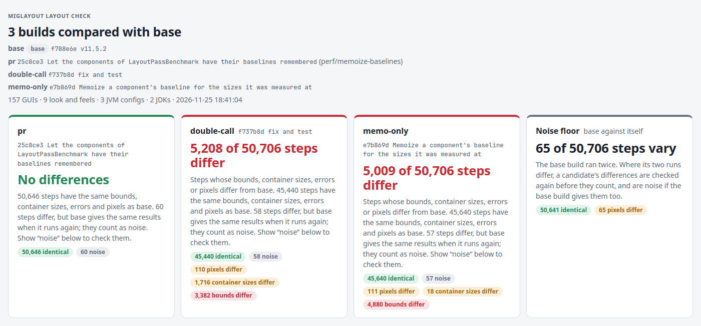
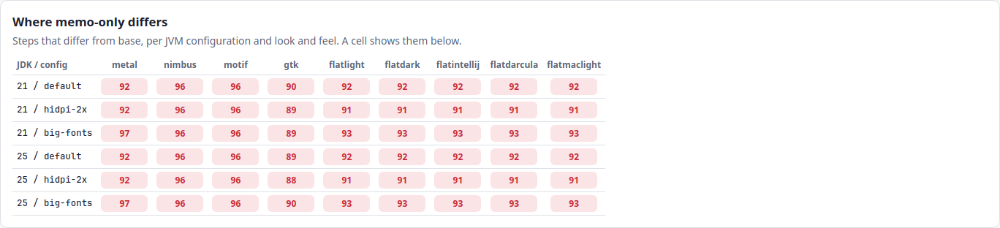
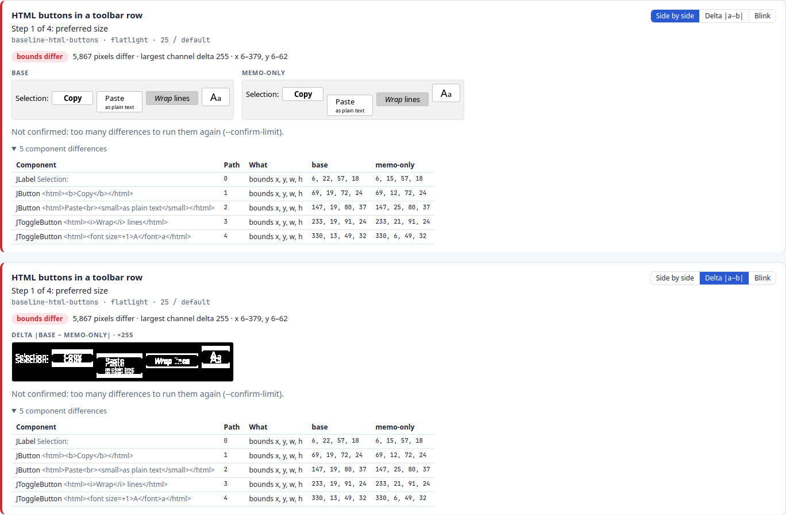
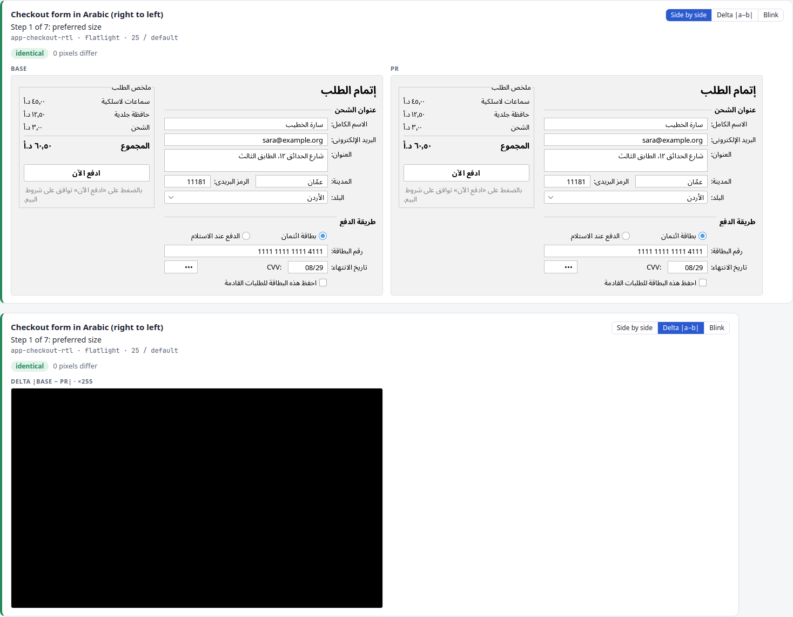

# MigLayout Layout Check

Does a change to [MigLayout](https://github.com/mikaelgrev/miglayout) move anything on screen?

`layout-check` takes two commits of MigLayout, builds both, and lays out 157 Swing GUIs with each one. It does this
in every look and feel your platform has, in several JVM configurations, and on any JDKs you name. Then it compares
every step of every GUI:

- the bounds of every component,
- the minimum and preferred size of every container MigLayout lays out,
- errors, and
- the screenshot, pixel for pixel.

The result is a report you open in a browser. It gives a verdict per build at the top, and below it every snapshot,
side by side or as a pixel delta, so you can see for yourself instead of trusting a number.

It was written to show that a performance change to MigLayout
([#118](https://github.com/mikaelgrev/miglayout/issues/118)) changes no layout. It works for any change to
MigLayout's core or Swing code.



## Quick start

You need Git, Maven, a JDK 21 or newer (with `javac`), Python 3.9 or newer with [Pillow](https://pypi.org/project/pillow/),
and a desktop session. The GUIs are never shown on screen, but Swing needs a display, so it can't run headless.

```sh
git clone https://github.com/Gleethos/miglayout-layout-check.git
cd miglayout-layout-check
pip install -r requirements.txt

./layout-check --repo ~/src/miglayout master my-branch
```

Give it any two commits: branch names, tags or commit ids. The first one is the base, the second the candidate. It
builds both with Maven, runs the check, prints a verdict per build, and writes the report to
`out/master-vs-my-branch/index.html`. The check takes about 10 minutes on 8 cores, and longer with several JDKs.

```
Base: master (f788e6e v11.5.2)
  my-branch              25353 steps: 29 noise  => NO DIFFERENCES
  (base again)           25353 steps: 35 pixels  => the base build varies by itself in these steps
Report: out/master-vs-my-branch/index.html
```

The exit status is 0 when nothing differs, 1 when something does, and 2 when the check could not run completely (a
bad option or ref, a failed build or JVM). So it also works as a CI step.

Where the commits come from:

| You run | Built from |
|---|---|
| `./layout-check A B` inside a MigLayout checkout | that checkout |
| `./layout-check --repo ~/src/miglayout A B` | that checkout |
| `./layout-check --repo https://github.com/you/miglayout.git A B` | a clone kept in `.cache/`, fetched on every run |
| `./layout-check A B` anywhere else | a clone of upstream MigLayout |

Builds are cached by commit in `.cache/builds/`, so only new commits get built.

## The report

At the top, each candidate gets a verdict: **No differences**, or how many steps differ and in what way. The *noise
floor* card shows what the base build does when it runs a second time.



Below that, a grid shows where a candidate differs, per JDK, JVM configuration and look and feel. Click a cell to
browse its snapshots.

In the snapshot browser, every step of every GUI is one card. You can filter by candidate, configuration, look and
feel, group or text, and choose to show the differences, the noise, or everything. Each card has three views:

- **Side by side**: the base build's screenshot next to the candidate's.
- **Delta |a−b|**: the absolute difference of the two, per colour channel. It is black wherever they are identical.
  By default every channel is multiplied by 255, so even a pixel that differs by one shade lights up. Switch the
  brightness to *Exact* to see the true delta.
- **Blink**: the two screenshots alternate in place.

The buttons above the list set the view for all cards; the buttons on a card change only that card. When a component
moved, the card lists it with its bounds in both builds.



When nothing differs, choose *everything* under *Show* and page through. Every delta is black.



## Telling regressions from noise

Not every GUI comes out the same in every JVM. GTK's text antialiasing, for one, varies between runs. To tell noise
from real changes:

1. The base build runs twice, to measure what varies by itself.
2. Every JVM in which a candidate differs runs again, three times with each build (`--confirm-runs`). A rerun lays
   out the same GUIs in the same order as the first run, because a difference can depend on what ran before it in
   the JVM (a static cache, for one).
3. A step counts as noise only when *every* result of the candidate equals some result of the base build. Where the
   base build doesn't even agree with itself on the pixels, that step compares only bounds, sizes and errors.
4. Without confirming (`--confirm-runs 0`, or a candidate over `--confirm-limit`), only pixel differences in steps
   where the base build's own pixels vary count as noise. Every other difference stays one.

Each card says which of these applied. A JVM that fails, or leaves no readable results, makes the exit status 2: its
GUIs could not be compared, so the check never says "no differences" for them.

## The GUIs

The GUIs are plain Java, in `java/src/layoutcheck/`:

| Group | What it covers |
|---|---|
| `Layout: …` | every part of the constraint language: layout, column, row and component constraints, docking, absolute positions, hidden components, content bias, nesting, and changes made while running |
| `Baseline: …` | baseline alignment in every situation where a baseline can depend on more than a size: HTML on components, renderers, editors and borders, scroll panes, mixed fonts, nesting, and changes that do not revalidate |
| `Apps: …` | complete dialogs, windows and forms like real applications have, including right-to-left and CJK text |

Each GUI goes through a few steps. By default it is shown at its preferred size, narrower, wider and taller, and at
its preferred size again. Many GUIs also change during a run the way applications do: they set new texts and fonts,
show, hide, add and remove components, replace constraints, and lay a nested panel out again directly. After each
step the runner validates the window the way Swing would on screen, then records the bounds and a screenshot.

To add one, write it in one of the `Scenarios*` classes (or a new one, registered in `Catalogue`):

```java
l.add(new Scenario("app-login", "Apps: dialogs", "Login", "A centered login form.", () -> {
	JPanel p = new JPanel(new MigLayout("wrap 2", "[right][200!]"));
	p.add(new JLabel("User:"));
	JTextField user = new JTextField();
	user.setName("user");
	p.add(user);
	...
	return p;
}).sizes().step("a long name", ctx -> ctx.<JTextField>find("user").setText("Bartholomew Montgomery-Smythe")));
```

`sizes()` adds the default steps; `step(label, action)` adds your own. Keep GUIs deterministic: no timers,
animations, clocks or focus, and no randomness without a fixed seed. The whole catalogue is compiled against the
base build, so use only API that both builds have.

## Options

| Option | Default | |
|---|---|---|
| `NAME=REF` | the ref | names a build in the report; more than one candidate is fine |
| `--laf NAME` | all that run here | `metal nimbus motif gtk windows windowsclassic aqua flatlight flatdark flatintellij flatdarcula flatmaclight` |
| `--config NAME=FLAGS` | `default`, `hidpi-2x`, `big-fonts` | JVM flags per configuration; `hidpi-2x` is `-Dsun.java2d.uiScale=2` |
| `--jdk [NAME=]HOME` | `java` on the PATH | repeat it to run every JDK |
| `--only REGEX` | all | the GUIs whose id matches |
| `--jobs N` | half the cores | JVMs at a time |
| `--confirm-runs N` | 3 | fresh runs of each build for every GUI that differs; 0 turns confirming off |
| `--confirm-limit N` | 30 | a candidate that differs in more JVMs (JDK, config and look and feel) than this is reported without confirming |
| `--probe-baselines` | off | lists the components whose `getBaseline(w, h)` depends on earlier calls; see below |
| `--out DIR` | `out/BASE-vs-CANDIDATE` | |
| `--report-only` | | rebuilds the report of `--out` from its results |
| `--open` | | opens the report when done |

For a quick look while you work, narrow it down:

```sh
./layout-check --laf flatlight --config default= --only '^app-' HEAD~1 HEAD
```

### The baseline probe

With `--probe-baselines`, every component of every GUI is also asked for its baseline at six sizes, in 24 random
orders. A component gets listed when the same size gets two different answers. Swing's HTML views do that: they
position the text using the layout of the previous question. A layout manager may only remember the baselines of
components that are not on this list. For builds that have `ComponentWrapper.isBaselineCacheable()`, the report
counts the listed components that such a build would still remember.

## Timing a layout pass

`layout-bench` runs MigLayout's own `LayoutPassBenchmark` with each build in one JVM, in random order over 40
rounds. It prints the median time of a pass and how often `getBaseline` is called. It opens a window while it runs.

```sh
./layout-bench --repo ~/src/miglayout master my-branch
./layout-bench --plain master my-branch     # plain Swing components, without the benchmark's counting overrides
```

## Example: remembering baselines (#118)

This is the check that was run for the baseline memo, on JDK 21 and 25 (f788e6e is MigLayout 11.5.2):

```sh
./layout-check --repo ~/src/miglayout --jdk 21=… --jdk 25=… --probe-baselines \
    base=f788e6e pr=perf/memoize-baselines double-call=f737b8d memo-only=e7b869d
```

| Build | Steps that differ from 11.5.2 |
|---|---|
| `pr`: remember a baseline within one layout pass, only for components whose answer depends on the size alone | none of 50,706 (60 noise steps: GTK pixels that vary in 11.5.2 itself) |
| `memo-only`: the memo reverted from #119 | 5,009 of 50,706: 4,880 with different bounds |
| `double-call`: remember every baseline, but ask HTML components twice | 5,208 of 50,706: 3,382 with different bounds, 1,716 with different container sizes |

## How it works

```
layout-check            the command; layoutcheck/cli.py
layout-bench            the benchmark; layoutcheck/bench.py
layoutcheck/
  sources.py            finds the repository, resolves refs, builds jars with Maven, downloads FlatLaf
  java.py               compiles the GUI catalogue and runs it in fresh JVMs
  compare.py            compares two builds' results: bounds, sizes, errors, pixels; writes the deltas
  confirm.py            lays differing GUIs out again and tells regressions from noise
  report.py, report.html  the report
java/src/layoutcheck/
  Runner.java           lays out the catalogue in one look and feel, writes results.json and a PNG per step
  Probe.java            the baseline probe
  Scenario.java, StepContext.java   a GUI and its steps; what a step can do
  Scenarios*.java, Catalogue.java   the GUIs
```

Each JVM runs one build in one JDK, configuration and look and feel. It writes
`out/<run>/results/<jdk>/<config>/<build>/<laf>/results.json` and a screenshot per step. The deltas go to
`out/<run>/deltas/…`, and the report reads both. A window is created for each GUI but never shown. It is an
undecorated, packed `JFrame`, sized per step, and it is validated until the whole tree is valid and no events are
pending. Screenshots are taken with `printAll`.

## License

MIT, see [LICENSE](LICENSE). MigLayout itself is BSD-licensed; this tool only builds and runs it.
